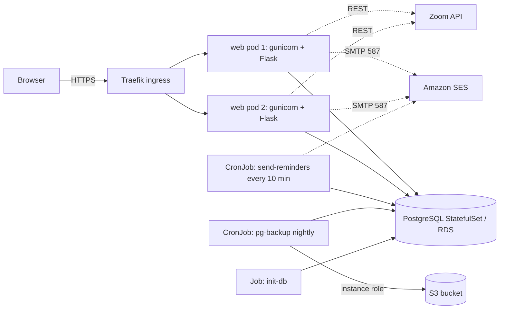
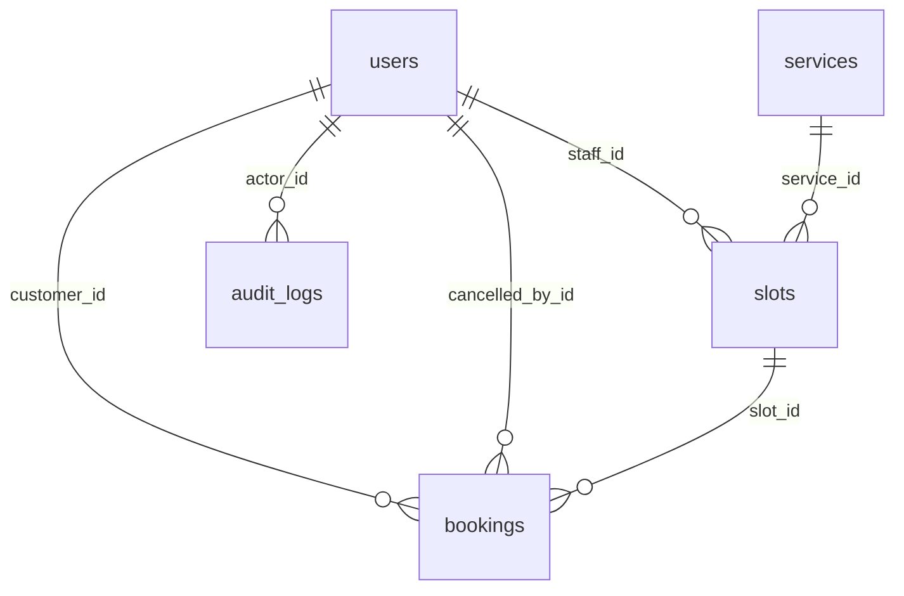

# Architecture — Booking Portal

> **Keep this file current.** Any change to structure, data model, routes, configuration, deployment or dependencies
> must update this document in the same commit (see [Agents.md](Agents.md)). Product behaviour lives in [PRD.md](PRD.md).

## 1. System overview

A server-rendered Flask application (Jinja templates + Bootstrap from a CDN) backed by PostgreSQL. It is packaged as one
Docker image and run on Kubernetes (k3s on a single AWS EC2 instance). Email goes out through SMTP (Amazon SES);
optional Zoom meetings via the Zoom REST API; nightly backups go to S3.



## 2. Repository layout

```
app/
  __init__.py          create_app(): config, extensions, blueprints, filters, security headers, error pages, CLI commands
  config.py            load_config(): every setting comes from environment variables
  extensions.py        db (SQLAlchemy), login_manager, csrf, migrate
  models.py            ORM models and role/status constants
  security.py          roles_required, is_safe_next, audit(), password-reset token helpers
  timeutils.py         UTC <-> local conversion, month helpers
  calendar_util.py     month_grid(): Sunday-first calendar built with the stdlib `calendar`
  blueprints/
    auth.py            login, logout, register, forgot/reset password, account (change password)
    customer.py        slots browsing, book, my-bookings, cancel, reschedule
    staff.py           schedule dashboard, create/delete slots, cancel/complete bookings
    admin.py           users, services, all bookings, audit log
    health.py          /healthz, /readyz
  services/
    booking.py         ALL booking business rules (atomic claim, limits, overlap, cancel, reschedule, slots)
    notifications.py   every email the portal sends + due-reminder sweep
    email.py           SMTP transport (thread for requests, synchronous for the reminder job)
    zoom.py            optional Zoom client (token cache, create/delete meeting; never raises)
  templates/           Jinja templates (base, _macros, auth/, customer/, staff/, admin/, error)
migrations/            Alembic migrations (Flask-Migrate); versions/ holds the schema history
tests/                 pytest suite
backup/                backup.sh / restore.sh + Dockerfile for the S3 backup job image
k8s/                   Kubernetes manifests (kustomize)
docs/                  PRD.md, Architecture.md, Agents.md, DEPLOY_AWS_EC2.md
CLAUDE.md              Entry point for Claude Code; points to docs/Agents.md
Dockerfile, docker-compose.yml, wsgi.py, requirements*.txt, pytest.ini, .github/workflows/ci.yml
```

**Layering rule:** blueprints parse the request, check roles/ownership, call `services/*`, and render. Business rules
live only in `services/booking.py`. Services never import blueprints. Templates contain no business logic.

## 3. Technology

Python 3.12 (Docker) · Flask 3.1 · Flask-SQLAlchemy / SQLAlchemy 2 · Flask-Login · Flask-WTF (CSRF) · Flask-Migrate
(Alembic) · gunicorn · httpx · PostgreSQL 16 (psycopg2) · Bootstrap 5 (CDN). Tests: pytest. CI: GitHub Actions.

## 4. Data model



| Table | Key columns | Notes |
|---|---|---|
| `users` | `email` (unique, lower-case), `name`, `password_hash`, `role` (`superadmin`/`staff`/`customer`), `active`, `failed_logins`, `locked_until`, `reset_requested_at` | Lockout and reset throttling state live here |
| `services` | `name` (unique), `description`, `duration_minutes`, `use_zoom`, `active` | Replaces the old hardcoded "General" type |
| `slots` | `staff_id`, `service_id`, `start_at`, `end_at` (naive UTC), `is_booked`, `active` | `is_booked` is the atomic-claim flag; `active=false` is a soft delete. Indexes `(staff_id,start_at)`, `(start_at,is_booked)` |
| `bookings` | `slot_id`, `customer_id`, `notes`, `status` (`confirmed`/`completed`/`cancelled`), `zoom_meeting_id`, `zoom_link`, `cancelled_by_id`, `cancel_reason`, `cancelled_at`, `reminder_sent_at` | One slot can have many bookings over time (history); at most one confirmed/completed |
| `audit_logs` | `actor_id`, `action`, `detail`, `created_at` (indexed) | Append-only |

Conventions: all datetimes are **naive UTC**; convert only at the edges (`timeutils`, Jinja filters `dt`, `tm`, `dkey`,
`dlong`). Booking cancellation sets `slot.is_booked=false` but keeps the booking row.

## 5. Key design decisions

1. **Atomic slot claim.** `UPDATE slots SET is_booked=true WHERE id=? AND is_booked=false AND active AND start_at>now`;
   success is `rowcount == 1`. This works identically on PostgreSQL and SQLite and needs no explicit locks.
   Booking then inserts the `Booking` row in the same transaction. Reschedule claims the new slot first and only then frees the old.
2. **Soft-delete slots with history.** Hard-deleting a slot that has (cancelled) bookings would break foreign keys and
   history, so such slots get `active=false`; slots with no bookings are deleted.
3. **Stateless web tier.** Sessions are signed cookies, password-reset tokens are stateless signed tokens containing a
   fingerprint of the current password hash (so they die after use). Lockout/throttle state is in the DB, so it holds across replicas.
4. **Side effects after commit, never fatal.** Zoom and email run after the database commit; every failure is
   logged and swallowed. A booking is never rolled back because Zoom or SMTP is down.
5. **Emails.** Request handlers send in a background thread (non-blocking). The reminder sweep sends synchronously so
   it only sets `reminder_sent_at` after a successful delivery; the sweep is idempotent and safe to run from a CronJob.
   In tests (`TESTING=True`) messages are captured in `app.extensions["outbox"]`.
6. **Migrations are the schema authority.** `flask init-db` runs `upgrade()`; a test asserts that migrations produce
   exactly the schema in `models.py`. Never edit the schema without a migration.
7. **Configuration only from the environment.** No secrets in code, images or git. `SECRET_KEY` is required in production.
8. **No client-side JavaScript requirements.** Confirmations are separate pages; the CSP only allows self + jsDelivr.

## 6. HTTP surface

| Method | Path | Role | Purpose |
|---|---|---|---|
| GET | `/` | any | Redirect to login or role home |
| GET/POST | `/login`, `/register`, `/forgot-password`, `/reset-password/<token>` | public | Auth flows |
| POST | `/logout` | auth | Log out |
| GET/POST | `/account` | auth | Change password |
| GET | `/slots` | customer | Browse free slots (`month`, `date`, `service`) |
| GET/POST | `/book/<slot_id>` | customer | Confirm and create a booking |
| GET | `/my-bookings` | customer | Upcoming and history |
| GET/POST | `/bookings/<id>/cancel`, `/bookings/<id>/reschedule` | customer (owner) | Cancel / reschedule |
| GET | `/staff/` | staff, superadmin | Own schedule calendar |
| POST | `/staff/slots`, `/staff/slots/<id>/delete` | staff, superadmin | Create / remove own slots |
| GET/POST | `/staff/bookings/<id>/cancel`; POST `/staff/bookings/<id>/complete` | staff, superadmin | Manage bookings on own slots |
| GET | `/admin/users`; GET/POST `/admin/users/new`, `/admin/users/<id>`; POST `/admin/users/<id>/unlock` | superadmin | User management |
| GET | `/admin/services`; GET/POST `/admin/services/new`, `/admin/services/<id>` | superadmin | Service management |
| GET | `/admin/bookings`; GET/POST `/admin/bookings/<id>/cancel` | superadmin | All bookings |
| GET | `/admin/audit` | superadmin | Audit log |
| GET | `/healthz`, `/readyz` | public | Liveness, readiness (DB) |

Authorization: `roles_required(...)` on every protected route; customer/staff resources are additionally scoped to the
owner (a non-owner gets 404, not 403). All POSTs require a CSRF token.

## 7. CLI commands (Flask)

| Command | Purpose |
|---|---|
| `flask init-db` | Wait for the DB, apply migrations, seed the default service, create the first super admin from `SUPERADMIN_*` if none exists. Idempotent |
| `flask send-reminders` | Email due reminders (run every ~10 minutes) |
| `flask create-user EMAIL NAME ROLE` | Create a user (prompts for the password) |
| `flask db migrate -m "..."` / `flask db upgrade` | Author / apply migrations |

## 8. Deployment topology

- **Image:** `Dockerfile` (python:3.12-slim, non-root UID 10001, gunicorn on :8000, `HEALTHCHECK`). A second small image
  (`backup/Dockerfile`: alpine + postgresql16-client + aws-cli) runs the backup.
- **Local:** `docker-compose.yml` — `db` (Postgres 16 on the named volume `booking_pgdata`), `init` (one-shot), `web`,
  `reminders` (loop), `mailpit` (profile `dev`).
- **Kubernetes (`k8s/`, kustomize):** namespace `booking`; ConfigMap (non-secret settings); Secret created out-of-band
  (never committed); `postgres` StatefulSet with a 10Gi PVC (or use RDS and drop it); `booking-web` Deployment (2
  replicas, probes, resource limits, read-only root FS, dropped capabilities, rolling update `maxUnavailable: 0`);
  Service; Traefik Ingress; HPA (2–4 on CPU); `booking-init-db` Job (migrations); `booking-reminders` CronJob (every 10 min);
  `pg-backup` CronJob (nightly, 02:30 SGT, uploads a `pg_restore -l`-verified dump to S3 using the EC2 instance role).
- **Hosting:** one EC2 instance running k3s; HTTPS via cert-manager + Let's Encrypt. Details: [DEPLOY_AWS_EC2.md](DEPLOY_AWS_EC2.md).
- **Update flow:** build image → import into k3s → bump `newTag` → run init Job (migrations first) → `kubectl apply -k` (rolling update).
  Migrations must stay backward compatible with the previous release.

## 9. Testing and CI

- `pytest` (≈63 tests): auth and role separation, lockout, open-redirect protection, CSRF, booking rules (atomic claim,
  limit, overlap, reschedule, cancel ownership, soft-delete), staff/admin guardrails, calendar correctness (incl. December),
  Zoom failure isolation, email/reminder behaviour, password reset, and a migration-vs-models drift check.
- Default run uses a temporary SQLite file; set `TEST_DATABASE_URL` to run the same suite on PostgreSQL.
- `.github/workflows/ci.yml`: lint (pyflakes) → tests on SQLite and PostgreSQL → `init-db` against PostgreSQL → build both
  images and smoke-test `/healthz` → optional publish to ECR when the repo variable `AWS_ROLE_ARN` is set.

## 10. Operational notes and risks

- HTTPS is required in production because session cookies are `Secure`.
- Backups live in S3 (30-day lifecycle); the in-cluster Postgres disk is a single point of failure — prefer RDS for production.
- The instance metadata hop limit must be 2 so backup pods can use the instance role.
- Amazon SES sandbox restricts recipients until production access is granted.
- Rotate any credentials that were ever committed to the repository history (the original Telegram bot token, Zoom secret and admin password).
